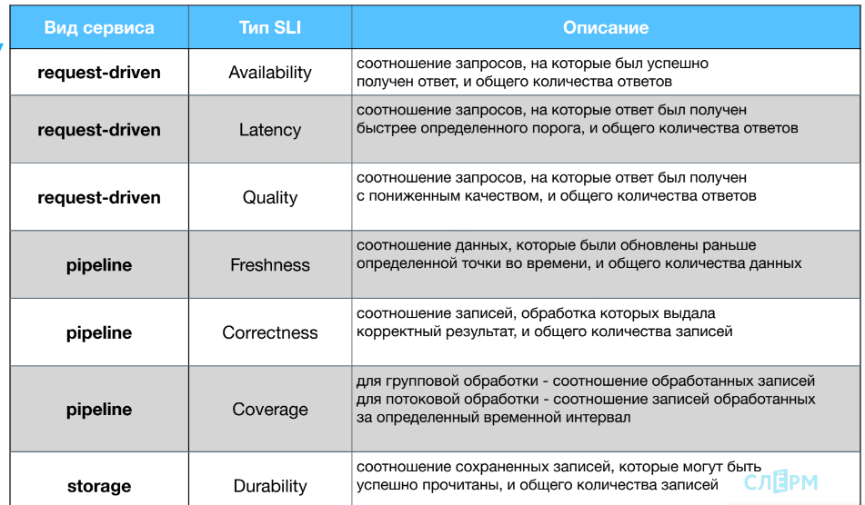
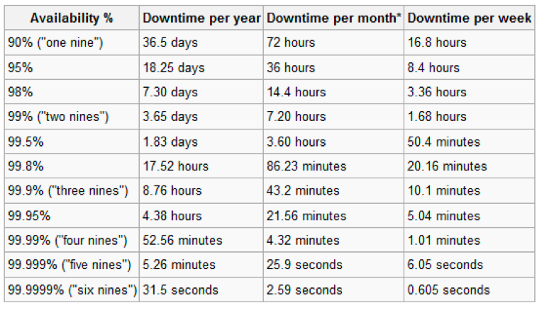
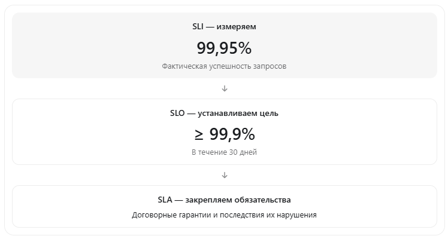

# Первое, с чего начинается SRE-подход, — это три ключевых понятия: SLI, SLO и SLA.

Они помогают ответить на главный вопрос: «Как понять, работает ли наш сервис хорошо?»

## SLI (Service Level Indicator)

SLI — это метрика, которая отражает фактическое качество работы сервиса с точки зрения пользователей.

SLI отвечает на вопрос: «Насколько хорошо сервис работает на самом деле?».

> Обычно выражается в процентах: 100% — идеально, 0% — всё сломалось.

Примеры групп SLI:

* Request-driven: HTTP, RPC-запросы
* Pipeline: очереди, потоки данных
* Storage: базы, кеши, файловые хранилища

### Основные типы SLI

| Система  | SLI          | Что измеряет                                        |
| -------- | ------------ | --------------------------------------------------- |
| API      | Availability | Доля успешно обработанных запросов                  |
| API      | Latency      | Доля запросов, выполненных быстрее заданного порога |
| API      | Quality      | Доля запросов, обработанных с требуемым качеством   |
| Storage  | Durability   | Сохранность записанных данных                       |
| Pipeline | Freshness    | Насколько актуальны обработанные данные             |
| Pipeline | Correctness  | Доля корректно обработанных записей                 |
| Pipeline | Coverage     | Полнота обработки входящих данных                   |

### Примеры применения

1. Availability — доступность API
   Из 100 000 запросов успешно обработано 99 950.

   SLI = 99,95%.

   Если SLO составляет 99,9%, цель выполняется.

2. Latency — задержка API

   Из 100 000 запросов 99 000 завершились быстрее 300 мс.

   SLI = 99%.

   Важно: latency SLI в данном случае — доля быстрых запросов, а не среднее время ответа. Дополнительно можно отслеживать p95 и p99.

3. Quality — качество

   API может вернуть HTTP 200, но предоставить неполные или некорректные данные.

   Quality SLI позволяет учитывать ошибки, которые обычный показатель доступности не обнаруживает.

4. Durability — сохранность данных

   Показывает, насколько надёжно система сохраняет записанные данные и позволяет прочитать их впоследствии.

   В отличие от Availability, Durability характеризует именно риск потери данных.

5. Freshness — актуальность данных

   Например, данные из Kafka должны появляться в аналитической базе не позднее чем через 60 секунд после поступления события.

6. Correctness — корректность обработки

   Показывает долю записей, для которых pipeline сформировал правильный результат.

7. Coverage — полнота обработки

   Например, из 1 000 000 входящих событий обработано 999 000.

   Coverage = 99,9%.

## SLO (Service Level Objective)

SLO — это целевое значение качества сервиса. Или иначе: что мы считаем “нормальной” работой с точки зрения пользователя.

> SLO — это измеримая цель, определяющая, насколько надёжно и качественно должен работать сервис за определённый период времени.
> Если SLO выше — пользователи довольны, если ниже — жалуются и начинают уходить.

SLO — это инструмент data-driven приоритизации. На него мы опираемся при планировании, выборе задач, запуске изменений.

Если то SLI показывает, что у вас по факту 99.2%, то SLO — это «хочу, чтобы 99.9% запросов были успешными».

Чтобы сформулировать SLO, нужно ответить на три вопроса:

* Что измеряем?
* За какой интервал времени?
* Какое целевое значение метрики считаем приемлемым?

Например:

> 99,9% HTTP-запросов к API должны завершаться успешно в течение 30 дней.

Шаги по установке SLO:

* Определить сервисы, важные для пользовательского опыта.
* Выбрать метрики для этих сервисов.
* Посмотреть на текущие значения метрик (baseline).
* Установить реалистичные, достижимые цели, к которым стоит стремиться.

## SLA (Service Level Agreement)

SLA — это внешнее обещание клиенту.

Документ, в котором бизнес обязуется поддерживать определённый уровень сервиса. 
Если SLA нарушается — могут быть штрафы, компенсации или репутационные потери.

> SLA строится на основе SLO, но закрепляется юридически.

### Связь SLI, SLO и SLA

|Термин|Что это|Для кого|
|-|-|-|
|SLI|Фактическая метрика|Для инженеров|
|SLO|Цель по метрике|Для команды|
|SLA|Обязательство перед клиентом|Для бизнеса|

> Эти три понятия — база, с которой начинается культура надёжности.
> SLO, SLI и SLA — это как линейка, по которой мы проверяем, всё ли идёт по плану.
 

## Важные нюансы для SRE

При проектировании архитектуры полезно начинать с пользовательских сценариев и выбирать SLI, которые отражают их реальное качество, а не только техническое состояние серверов.

Не все SLI обязательно выражаются в процентах. Например, задержка обработки или возраст данных могут измеряться в миллисекундах и секундах.

Также при проектировании SLI необходимо определить, что именно считается успешной операцией, какие события входят в знаменатель и откуда берутся измерения.
