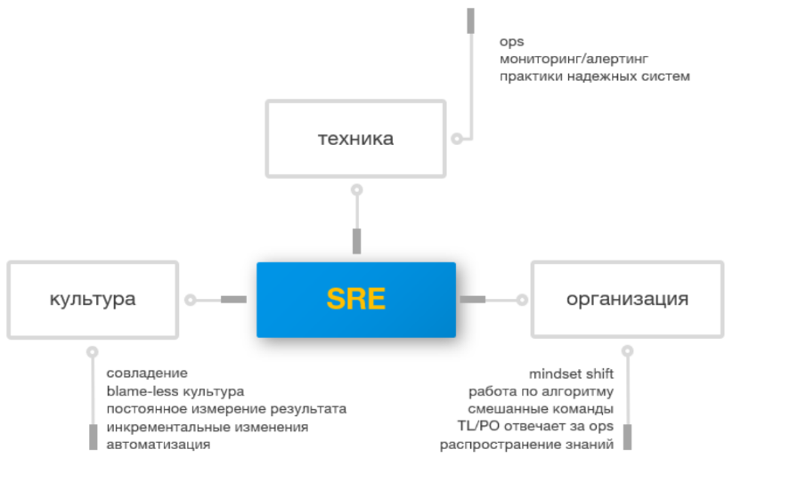

# SRE (Site Reliability Engineering) — подход к разработке и эксплуатации, инженерия надёжности.

Определение от Google:

> SRE — это то, что вы получаете, если начнёте решать операционные задачи как инженерные. Миссия SRE — защищать, запускать и развивать программное обеспечение и системы, обеспечивающие публичные сервисы. Всё внимание — на доступность, задержки, производительность и масштабируемость.

Мое понимание: 

> SRE — инженерная дисциплина, направленная на обеспечение надёжности, доступности и производительности программных систем с применением подходов разработки ПО. 

SRE — это взгляд на всю систему целиком.

SRE смотрит на сервис глазами пользователя:

* Что не работает?
* Где просадка в скорости?
* Почему что-то недоступно?

Одновременно SRE видит внутренности системы:

* знает, как устроены компоненты,
* как распределяется нагрузка,
* где может быть узкое место,
* и как быстро починить, если что-то пошло не так — как в коде, так и в инфраструктуре.

SRE — это подход всей команды: разработчики, техлиды и тимлиды, продакт-менеджеры и инфраструктурные инженеры.

Главная цель SRE — обеспечить такой уровень надёжности продукта, при котором он приносит пользу клиентам, сохраняя баланс между стабильностью системы, скоростью внедрения новых функций и стоимостью.

Ключевые принципы:

- Reliability — надёжность системы.
- [SLI / SLO](../sli-slo-sla/index.md) — измерение и определение целевого уровня качества сервиса.
- Error Budget — допустимый уровень ненадёжности, позволяющий балансировать стабильность и развитие.
- Observability — понимание состояния системы через метрики, логи и трассировки.
- Automation — автоматизация рутинных операций и снижение ручного труда.
- Incident Management — обнаружение, устранение и анализ инцидентов
- Мониторинг и Алертинг.
- Культура, в которой эксплуатация — такая же часть работы, как и написание кода.
